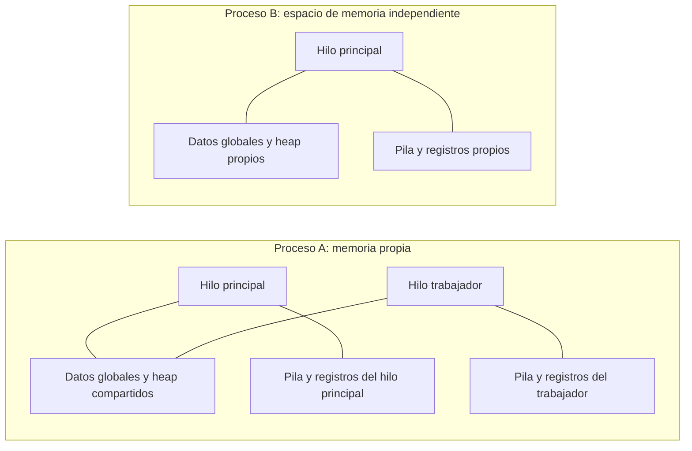
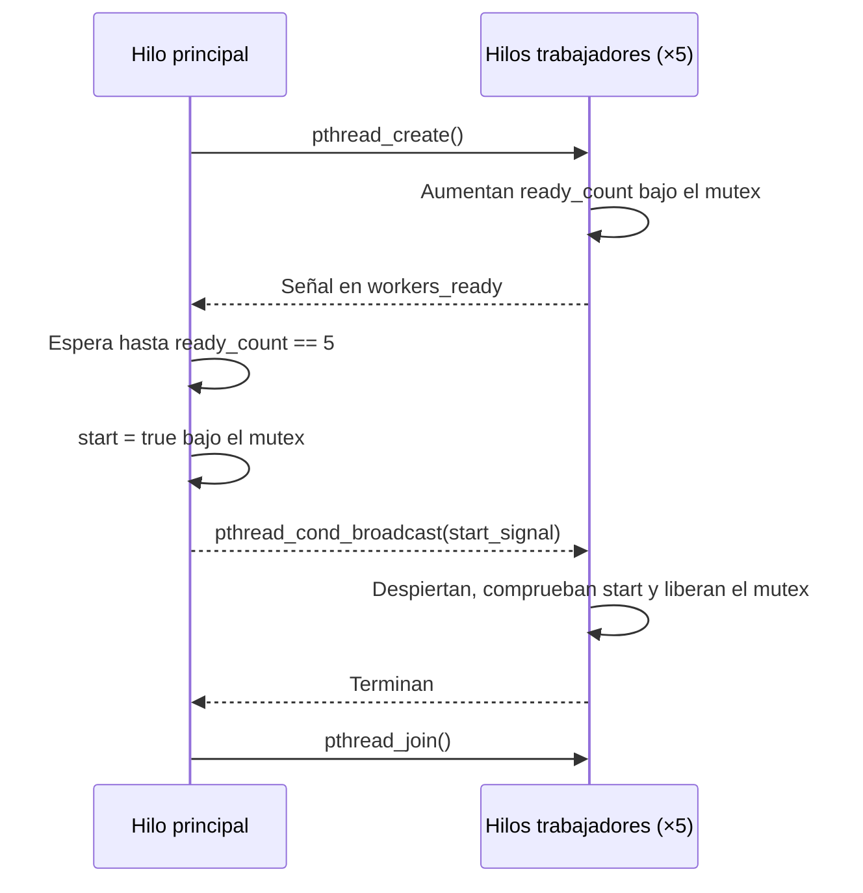

# Proyecto 3: Hilos POSIX (pthreads)

Universidad de El Salvador · Gestión y Programación de Sistemas Operativos I · Ciclo II/2026

## Desarrollo teórico

Un **proceso** es un programa en ejecución con su propio espacio de memoria y recursos del sistema. Los **hilos** son flujos de ejecución dentro de un proceso: comparten su memoria global y sus recursos, pero cada hilo conserva su propio contador de programa, registros y pila. Crear hilos suele ser más liviano que crear procesos; a cambio, el acceso concurrente a datos compartidos debe sincronizarse.

La API POSIX para hilos se declara en `<pthread.h>`:

- `pthread_create()` inicia un hilo y ejecuta una función con un argumento.
- `pthread_join()` espera a que un hilo termine; permite coordinar el cierre y recoger su resultado.
- Un **mutex** (`pthread_mutex_t`) permite que solo un hilo a la vez entre a una sección crítica. Se bloquea con `pthread_mutex_lock()` y se libera con `pthread_mutex_unlock()`.
- Una **variable de condición** (`pthread_cond_t`) permite dormir hasta que otro hilo anuncie un cambio de estado. `pthread_cond_wait()` libera el mutex mientras espera y lo vuelve a adquirir antes de retornar. La condición debe revisarse en un ciclo `while`, porque puede haber despertares espurios o el estado puede cambiar antes de que el hilo obtenga el mutex.

### Procesos e hilos

Cada proceso tiene su propio espacio de memoria. En cambio, los hilos de un mismo proceso comparten datos globales y memoria dinámica, pero cada uno mantiene su propia pila y registros.



## Ejercicio 1: contador global protegido

El programa crea cinco hilos. Cada uno incrementa 100 000 veces el contador global y protege cada modificación con el mismo mutex. Al finalizar, el resultado esperado es **500 000**. `pthread_join()` garantiza que el contador se lea después de que todos los hilos terminen.

## Ejercicio 2: sincronización con condición

Se crean cinco trabajadores que anuncian que están listos y esperan en `pthread_cond_wait()`. El hilo principal también espera hasta que los cinco estén listos; entonces actualiza el predicado `start` bajo el mutex y llama a `pthread_cond_broadcast()`. Los trabajadores revisan ese predicado en un `while` antes de continuar. Se usan dos variables de condición para separar la notificación de “trabajadores listos” de la señal de “comenzar”.



El mutex protege tanto `ready_count` como `start`. La señal solo avisa que el estado puede haber cambiado; el `while` verifica que la condición realmente se cumpla.

## Compilar y ejecutar

En Linux, con [xmake](https://xmake.io/) instalado:

```sh
xmake
xmake run SysCore             # Ejecuta los dos ejercicios
xmake run SysCore -- contador # Solo ejercicio 1
xmake run SysCore -- condicion # Solo ejercicio 2
```

El argumento `todo` también ejecuta ambos ejercicios; si no se indica argumento, ese es el comportamiento predeterminado.

También se puede compilar directamente:

```sh
g++ -std=c++11 -Wall -Wextra -pthread src/main.cpp -o syscore
./syscore
```
