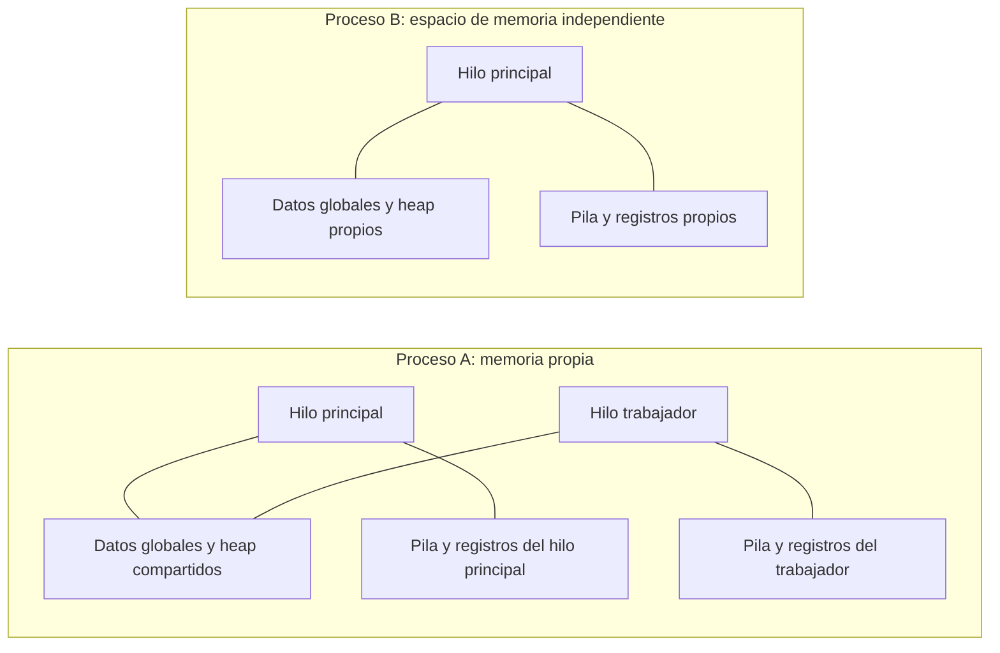
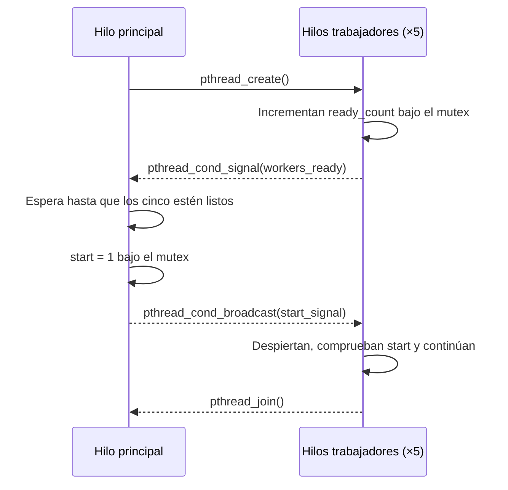

# Proyecto 3: Hilos POSIX (pthreads)

Universidad de El Salvador · Gestión y Programación de Sistemas Operativos I · Ciclo II/2026

## Desarrollo teórico

Un **proceso** es un programa en ejecución con su propio espacio de memoria y recursos del sistema. Los **hilos** son flujos de ejecución dentro de un proceso: comparten memoria global y recursos, pero cada hilo mantiene su propio contador de programa, registros y pila. El acceso simultáneo a datos compartidos requiere sincronización.

La API POSIX para hilos se declara en `<pthread.h>`:

- `pthread_create()` crea un hilo y comienza a ejecutar una función.
- `pthread_join()` espera a que un hilo termine.
- Un **mutex** (`pthread_mutex_t`) protege una sección crítica mediante `pthread_mutex_lock()` y `pthread_mutex_unlock()`.
- Una **variable de condición** (`pthread_cond_t`) permite esperar hasta que cambie un predicado. `pthread_cond_wait()` libera el mutex mientras espera y lo vuelve a adquirir al despertar. El predicado se comprueba dentro de un ciclo `while`.

### Procesos e hilos

Cada proceso tiene memoria independiente. Los hilos de un proceso comparten los datos globales y el heap; cada uno conserva su propia pila y registros.



## Ejercicio 1: contador global protegido

El programa declara `shared_counter` en el ámbito global. Cinco hilos incrementan esa variable 100 000 veces cada uno. Cada incremento está protegido por `counter_mutex`; el resultado esperado es **500 000**. El programa informa de un error si el contador final no coincide con el valor esperado.

## Ejercicio 2: sincronización con condición

Se crean cinco trabajadores. Cada uno anuncia que está listo y espera en `pthread_cond_wait()` hasta que el hilo principal establezca el predicado `start`. El principal también espera, mediante una variable de condición, hasta que los cinco trabajadores estén listos. Luego cambia `start` bajo el mutex y usa `pthread_cond_broadcast()` para permitir que todos continúen. Los trabajadores vuelven a comprobar el predicado en un ciclo `while`.



## Compilar y ejecutar

En Linux, con GCC y [xmake](https://xmake.io/) instalados:

```sh
xmake clean
xmake
xmake run SysCore             # Ejecuta ambos ejercicios
xmake run SysCore contador    # Solo ejercicio 1
xmake run SysCore condicion   # Solo ejercicio 2
```

También se puede seleccionar explícitamente `todo` para ejecutar ambos ejemplos:

```sh
xmake run SysCore todo
```

Compilación directa como C11:

```sh
gcc -std=c11 -Wall -Wextra -Wpedantic -Werror -pthread src/main.c -o syscore
./syscore contador
./syscore condicion
./syscore todo
```

Verificación automatizada de resultados:

```sh
sh tests/test_syscore.sh build/linux/x86_64/release/SysCore
```

Las capturas y registros de las ejecuciones verificadas están en `evidencias/proyecto3/`.
